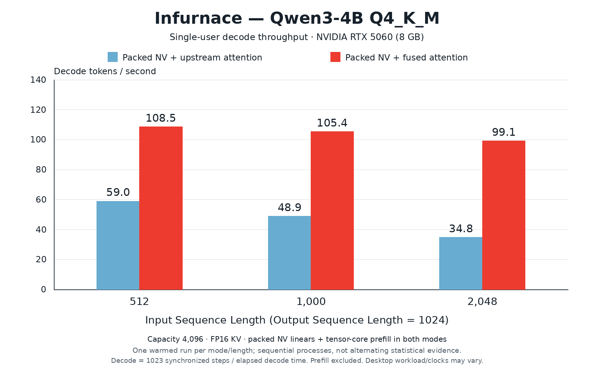

# Current decode benchmark



Vector image: `qwen3-4b-rtx5060-1k-output.svg`. Raw reports:
`qwen3-4b-rtx5060-1k-output-upstream.json` and
`qwen3-4b-rtx5060-1k-output-fused.json`.

| Prompt tokens | Upstream attention | Fused attention |
| --- | ---: | ---: |
| 512 | 58.97 tok/s | 108.55 tok/s |
| 1000 | 48.94 tok/s | 105.41 tok/s |
| 2048 | 34.78 tok/s | 99.12 tok/s |

Both modes use the same bundled Qwen3-4B Q4_K_M GGUF on an RTX 5060 8 GB,
253 packed NV linears, packed tensor-core prefill, FP16 KV cache, capacity 4096,
temperature zero, 32-token prefill chunks and 1024 generated outputs.
Input IDs come from `benchmark_prompt_ids()`. After `model.warmup()`,
`_measure()` resets history and runs full generation once per prompt length.
Decode throughput is 1023 synchronized steps divided by time from first output
to generation completion; prefill/first-token work is excluded. Context grows
throughout generation, so these are sustained averages, not fixed-context rates.
All runs completed their requested outputs.

The upstream-attention process ran first, then the fused-attention process.
One measurement per mode/length, no profiler or error bars. Desktop workloads,
GPU clocks and process order can influence absolute rates. This isolates
attention selection within Infurnace: **the blue bars are not stock tinygrad
without Infurnace's packed linear/prefill acceleration**. Fused attention uses
64-token partitions and wider KV staging.

Keep only the current benchmark set in this directory; replace it for the next
published measurement rather than accumulating historical charts.

Re-render (SVG requires only Python's standard library):

```sh
.venv/bin/python benchmarks/plot_decode.py \
  --upstream benchmarks/results/qwen3-4b-rtx5060-1k-output-upstream.json \
  --fused benchmarks/results/qwen3-4b-rtx5060-1k-output-fused.json \
  --output benchmarks/results/qwen3-4b-rtx5060-1k-output.svg
```

For PNG, use a Python environment with Pillow and DejaVu Sans fonts installed
and change the output suffix to `.png`. Pillow is not a runner dependency.
